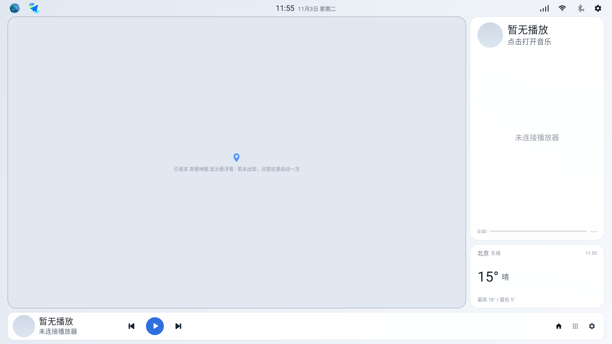
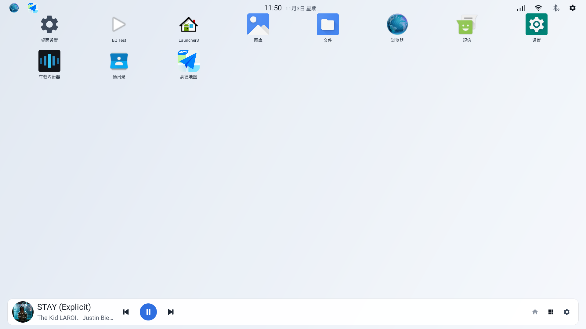
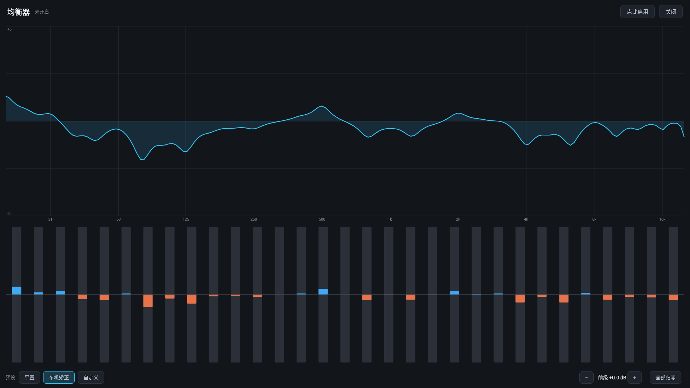

# CarLauncher

为 Android 车机从零写的桌面（Launcher），接管 HOME 键，替代原厂桌面。

界面骨架沿用原厂菱粉桌面的布局与 id 命名，**代码全部自研、零第三方 UI 库**（只依赖 AndroidX 与 Media3）。



<table>
<tr>
<td width="50%"></td>
<td width="50%"></td>
</tr>
<tr>
<td align="center">应用列表（图标随安装变化）</td>
<td align="center">31 段全局均衡器</td>
</tr>
</table>

---

## 为什么做这个

车机自带的桌面通常有三个问题：卡片不能自己排、歌词只显示两行、设置项一堆点不动。而市面上改版桌面大多是把原厂 APK 反编译改资源，升一次级就崩。

这个项目选择了麻烦的一条路：**重新写一个 Launcher**，把想要的功能做进代码里，这样每个行为都能调试、能改、能解释为什么。

目标设备：**MT8666 / 6GB / 1920×1080 / Android 9**。同时在 1280×720 与多种 dpi 下验证过自适应。

---

## 功能

### 桌面

- **接管 HOME**：`category.HOME` + `DEFAULT`，横屏锁定，全屏沉浸（隐藏系统状态栏与导航栏）
- **左图右卡**：左侧地图区，右侧卡片列，可用 `左图右乐 / 左乐右图` 切换左右
- **卡片自定义排序**：时间日期 / 音乐 / 负载 / 天气四张卡可任意上下调序，关掉的卡其余自动变大
- **状态栏**：时间与日期水平居中、信号格（自绘 4 档）、WiFi、蓝牙、设置齿轮
  - WiFi / 蓝牙单击即真实开关，长按进系统设置
  - 三态显示：已连接 = 加粗 / 已开未连 = 带问号 / 已关 = 红色叉
- **左上角快捷应用**：设置里打开后可选 2~5 个应用并自己排序；关着时只显示一个「···」
- **应用列表**：图标随安装/卸载实时刷新（包广播 + 防抖），长按弹菜单（应用信息 / 卸载）
- **悬浮地图**：打开桌面时自动拉起指定地图全屏导航，2 秒后返回桌面，地图区绘可配色描边

### 音乐卡

- 封面 / 歌名 / 歌手 / 进度 / 播放控制，**歌词按高度自适应 3 / 5 / 7 行**
- 长歌词单行字幕式滚动：溢出时自己 `canvas.drawText`，不依赖 TextView 排版
- 播放时当前行放大高亮；暂停时动画 `pause()` 而不是归零重扫
- **底栏隐藏时自动接管播放控制**（底栏显示时卡片只留歌词，零占位）

### 均衡器

- **31 段全局 EQ**，挂在 `DynamicsProcessing` 的 session 0 上，所有 App 的声音都会过它
- 内置「车机矫正」曲线（20 点实测拟合到 31 段，误差 0.02 dB）、平直、自定义
- 双击推子可输入数值；支持前级增益
- **用手机网页填 Key / JWT**：车机上打字太痛苦，起一个带 PIN 的临时局域网页面，手机填完提交

### 天气

- 和风天气**直连**，无中间服务
- 支持 **API KEY** 与 **JWT**（Ed25519 自签，纯 Java 实现，兼容 Android 9 没有 `KeyFactory("Ed25519")` 的情况）
- **定位反查城市**：卡片显示「枣庄 市中」两级地名，市名大、区名小淡
- 断网时读本地缓存，不会退回空白

### 设置

八组设置：外观 / 卡片 / 音乐 / 音效 / 地图 / 天气 / 媒体 / 关于。全部即时生效，不需要重启桌面。

---

## 已知限制

这些是设计上的取舍或平台限制，不是没做完：

| 限制 | 说明 |
|---|---|
| **歌词需要 md3Music** | 歌词由播放器写进 `MediaItem.mediaMetadata.extras`，本项目通过 Media3 读取。换成别的播放器只能拿到歌名、封面、进度，没有歌词 |
| **悬浮地图需要悬浮修改版** | 官方高德/百度地图没有悬浮窗，延迟回桌面后桌面会盖住它。默认行为因此是「直接打开导航」，只有换用悬浮版地图时才切到悬浮模式 |
| **天气要自备 Key** | 和风免费额度够个人用，但要自己注册。代码里不含任何密钥 |
| **`targetSdk` 停在 28** | 车机是 Android 9。抬高会引入后台启动限制与分区存储，对桌面场景全是负收益 |
| **桌面 EQ 与 CarEQ 不能同开** | `AudioEffect` 对同一个 session 的控制权是排他的，后开的会抢走前一个。只开一个 |
| **没有油耗 / 行程数据** | 这两个字段走主机厂私有 binder，能读到但解析不出，相关代码已移除 |
| **蜂窝信号可能显示斜杠** | 走私有通道的车机上 `SignalStrength` 读不到 |

---

## 安装

需要车机已开启 ADB（多数车机在「关于」里连点版本号进开发者模式）。

```bash
adb install -r app-debug.apk

# 设为默认桌面
adb shell cmd package set-home-activity com.lf.launcher/.LauncherActivity
```

车机如果报权限不足，用 root 执行：

```bash
su -p -c "cmd package set-home-activity com.lf.launcher/.LauncherActivity"
```

装好后按 Home 键应直接回到本项目。想退回原厂桌面，在系统设置里改默认桌面应用。

---

## 构建

环境：**JDK 17+**（本项目用 JDK 21）、**Android SDK 34**、Gradle 9.x。

```bash
# 1. 指定 SDK 位置（不要提交这个文件）
echo "sdk.dir=/path/to/android-sdk" > local.properties

# 2. 编译
./gradlew assembleDebug
# 产物：app/build/outputs/apk/debug/app-debug.apk
```

> 仓库里不含 `local.properties`、签名文件和构建产物，都需要本地生成。
> 本项目默认用 debug 签名，装车机自用足够；要长期使用建议自己生成 keystore。

---

## 配置

### 天气

设置 → 天气 → 认证方式，二选一：

**API KEY**（推荐，最省事）
1. [console.qweather.com](https://console.qweather.com) 建项目，拿 API KEY
2. 同一页面顶部复制 **API Host**（形如 `abc1234xyz.re.qweatherapi.com`）
3. 在「和风 Key」里填，两个字段都要给

**JWT**（新项目只能这样）
1. 控制台生成 Key ID 与 Ed25519 私钥（整段 PEM）
2. 在「JWT 凭据」里填 Project ID / Key ID / 私钥
3. 同样需要填 API Host

嫌在车机上打字麻烦：**任一张输入框里点「用手机填」**，车机会起一个临时网页，手机浏览器打开后填完提交即可（局域网内，4 位 PIN，2 分钟过期）。

### 音乐

装 md3Music（本项目不附带）并在它的设置里**打开「歌词转发」**。不开的话桌面只能显示歌名和封面。

### 地图

设置 → 地图 → 当前地图，选一个已安装的地图应用。用官方版就保持「点按地图区 = 直接打开导航」；有悬浮修改版再打开「打开桌面时自动拉起地图」。

---

## 目录结构

```
app/src/main/
├── java/com/lf/launcher/
│   ├── LauncherActivity.kt      HOME 接管、ViewPager、状态栏、壁纸、自动拉起地图
│   ├── LauncherApp.kt           Application 入口
│   ├── home/                    首页：卡片编排、时钟、负载、天气渲染
│   ├── apps/                    应用网格 + PackageManager 查询
│   ├── music/                   Media3 MediaController 绑定与歌词时间轴
│   ├── lyric/                   LRC / ELRC 解析
│   ├── map/                     悬浮地图启动与回桌面
│   ├── eq/                      EQ 页面、编辑器视图、曲线持久化
│   ├── peq/                     31 段参数均衡算法与系统 EQ 挂载
│   ├── weather/                 和风直连、JWT、定位、手机导入页
│   ├── settings/                设置页（13 个文件：条目定义 / 适配器 / 各对话框）
│   └── ui/                      状态栏托盘、信号格自绘
└── res/
    ├── layout/                  首页、四张卡、状态栏、底栏、设置、EQ
    ├── values/                  默认档尺寸（宽 < 1400dp）
    └── values-w1400dp/          大屏档尺寸
```

**尺寸体系**：不写死像素。卡片高度用 `layout_weight` 分剩余空间，封面和按键用 `heightPercent + ratio` 等比缩放，只有字号与留白分两档 `dimen`。同一份布局在 607 / 720 / 1080dp 三种可用高度下都自洽。

---

## 文档

| 文件 | 内容 |
|---|---|
| [`docs/USAGE.md`](docs/USAGE.md) | **使用说明**：每一组设置做什么、怎么配天气/音乐/地图/EQ |
| [`docs/ARCHITECTURE.md`](docs/ARCHITECTURE.md) | 架构与实现细节：地图四通道、歌词链路、状态栏三态、尺寸体系 |
| [`docs/research/`](docs/research/) | 技术调研：AOSP 路径拆解、悬浮窗可行性实测、高德广播实测、md3Music 接口调研 |
| [`docs/changelog/`](docs/changelog/) | 逐版本变更说明（m4 → m47），每个 bug 的根因都写清楚了 |

---

## 相关项目

- **CarEQ**（`若已发布，把仓库地址填到这里`） — 从本项目的均衡器抽出、可单独安装的 31 段全局 EQ，带开机自启，不依赖任何其他 App

两者都挂 `session 0`，同时开启会互相抢控制权，只开一个。

---

## 许可

[MIT](LICENSE)。可以自由使用、修改、商用，保留版权声明即可。

第三方组件：AndroidX（Apache-2.0）、Media3（Apache-2.0）、和风天气 API（按其服务条款）。本项目不包含任何第三方应用的代码或资源。
